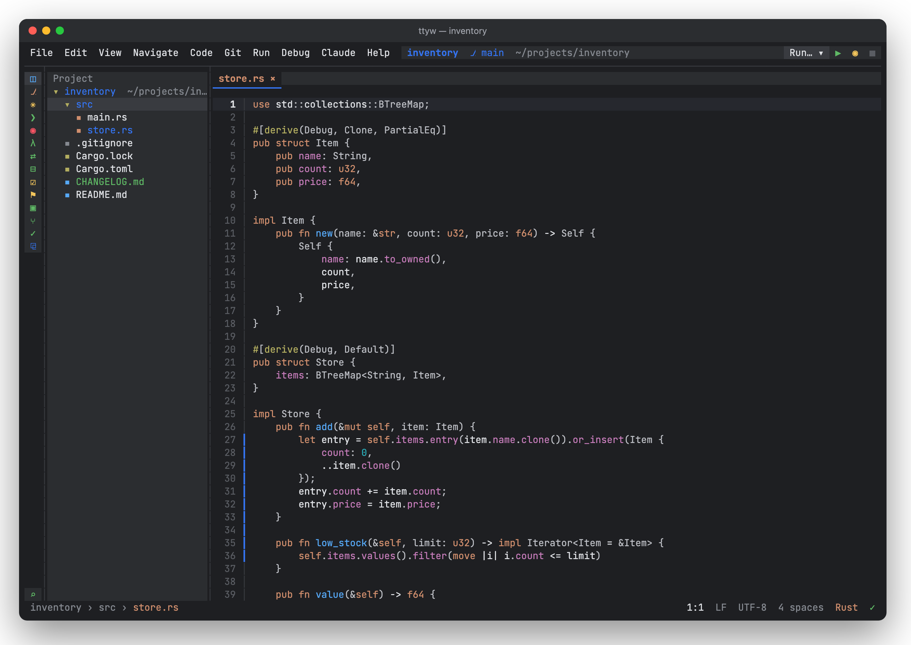
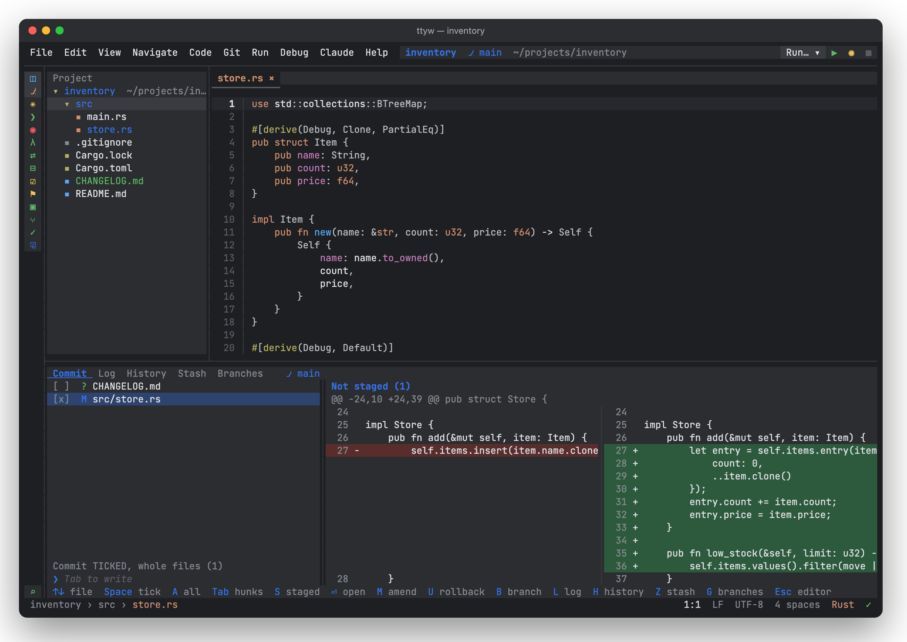
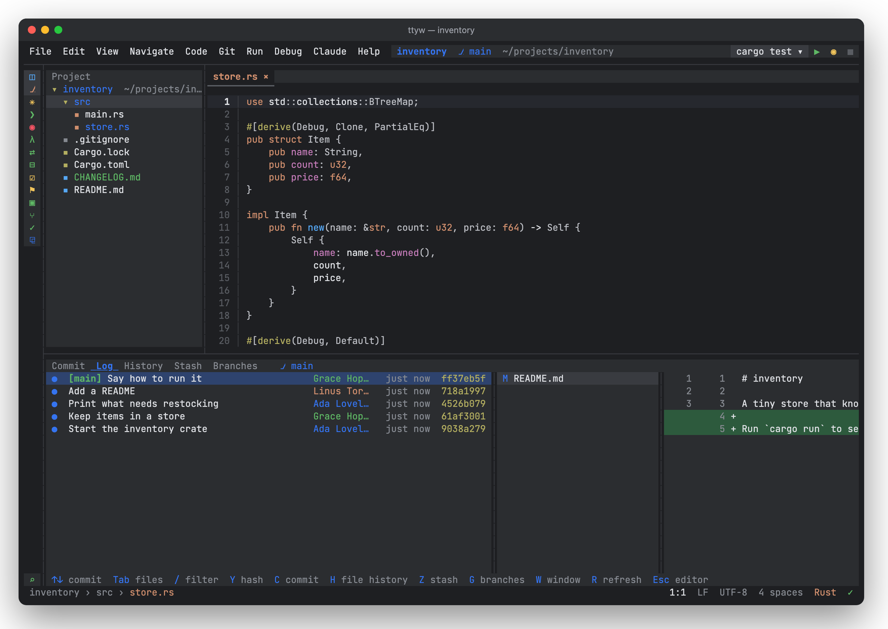
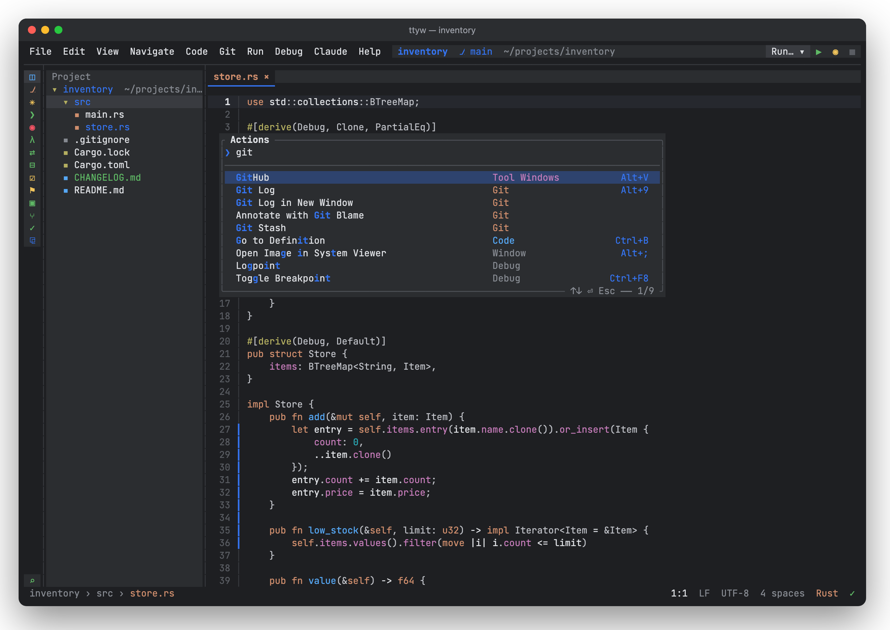
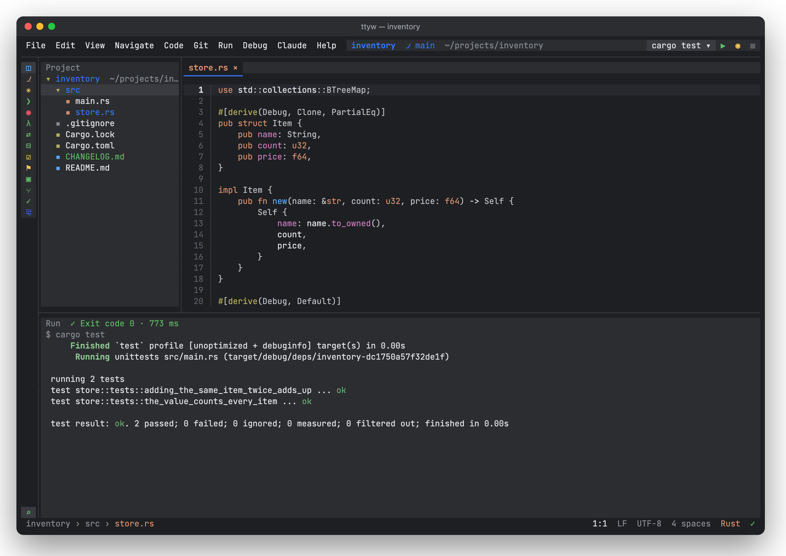
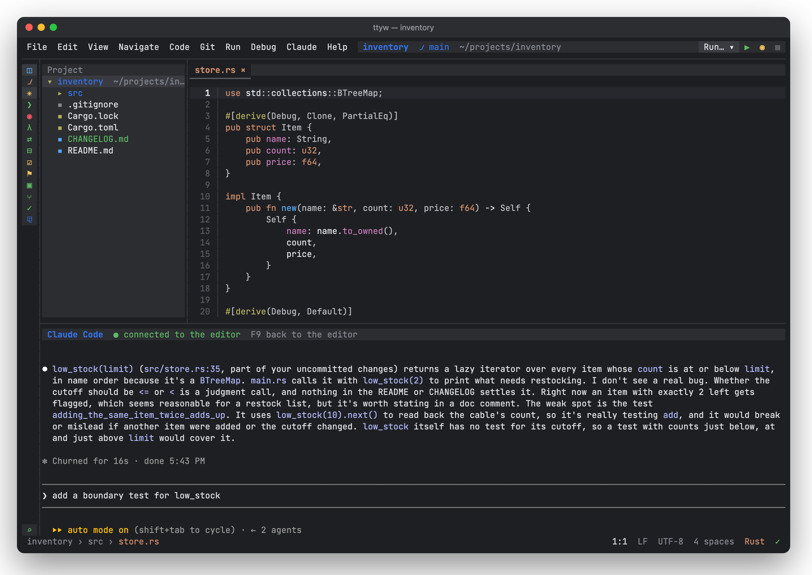

<div align="center">

# TTYwright

**A keyboard-first IDE that lives in your terminal**

Editor, Git, language servers, run and debug in one terminal window.<br>
Familiar IntelliJ IDEA–style shortcuts, and the mouse works too.

[Features](#features) · [Install](#install) · [Quick start](#quick-start) · [Shortcuts](#key-shortcuts)




</div>

## Features

<table>
<tr>
<td width="50%" valign="top">

### ✏️ Editor
Tabs, splits, tree-sitter highlighting for many languages, find and replace with regex and a project-wide preview, structural search by code shape, soft wrap, and Markdown preview right in the terminal.

</td>
<td width="50%" valign="top">

### 🧠 Language servers
Diagnostics, go to definition, completion, hover docs, find usages, rename, quick fixes and formatting. `rust-analyzer` installs itself.

</td>
</tr>
<tr>
<td valign="top">

### 🌿 Git
Log with a branch graph, commits by checkbox or partial staging by hunk and line, side-by-side diffs, conflicts, stash, branches, blame, push and pull.

</td>
<td valign="top">

### ▶️ Run and debug
Finds what to run: `cargo`, `npm`, `go`, `gradle`, `maven`, `composer`. Errors in the output are clickable. Debugging over DAP with breakpoints, watches and stepping.

</td>
</tr>
<tr>
<td valign="top">

### 🧰 Tools
Built-in terminal, Database panel (SQLite, Postgres, MySQL), HTTP client for `.http` files, Docker, GitHub, test coverage, duplicate detection, and Claude Code in a panel.

</td>
<td valign="top">

### 🛡️ Nothing gets lost
Every edit reaches a journal before it reaches the screen. Autosave, swap files and local history. An untrusted project never gets to run its code.

</td>
</tr>
</table>

## Screenshots

<table>
<tr>
<td width="50%"><p align="center"><b>Commit</b>: checkboxes, hunks, side-by-side diff</p></td>
<td width="50%"><p align="center"><b>Log</b>: history, files and the diff of a commit</p></td>
</tr>
<tr>
<td><p align="center"><b>Palette</b>: any action in a few keystrokes</p></td>
<td><p align="center"><b>Run</b>: programs, tests, jump to errors</p></td>
</tr>
<tr>
<td colspan="2"><p align="center"><b>Claude Code</b>: the real CLI in a panel, connected to the editor, sees the open file and selection</p></td>
</tr>
</table>

## Install

```bash
curl -fsSL https://raw.githubusercontent.com/Avead556/ttywright/main/install.sh | sh
```

The script downloads a prebuilt release for macOS or Linux (arm64 and x86_64) from [Releases](https://github.com/Avead556/ttywright/releases), verifies its checksum, installs it into `~/.local/share/ttywright` and links the `ttyw` command into `~/.local/bin`. No Rust toolchain needed, and `rust-analyzer` is bundled.

<details>
<summary>A specific version, custom folders, uninstalling</summary>

```bash
curl -fsSL https://raw.githubusercontent.com/Avead556/ttywright/main/install.sh | TTYWRIGHT_VERSION=v0.1.0 sh
curl -fsSL https://raw.githubusercontent.com/Avead556/ttywright/main/install.sh | TTYWRIGHT_HOME=~/apps/ttywright TTYWRIGHT_BIN_DIR=~/bin sh
```

Running the script again updates the install. To uninstall:

```bash
rm -rf ~/.local/share/ttywright ~/.local/bin/ttyw
```

</details>

<details>
<summary>Building from source</summary>

Requires stable Rust with edition 2024 (tested with 1.92) and a C compiler for the tree-sitter grammars.

```bash
git clone https://github.com/Avead556/ttywright.git
cd ttywright
cargo install --path .
```

The `ttyw` command lands in `~/.cargo/bin`. On the first `.rs` file the editor finds or fetches `rust-analyzer` by itself.

</details>

## Quick start

```bash
ttyw              # the current folder as a project
ttyw ~/code/app   # a given folder
ttyw src/main.rs  # open a file
```

Tabs, splits and cursor positions come back on the next start. The first time you open a folder, the editor asks whether to trust it: without trust, nothing from the project is executed.

## Key shortcuts

| Action | Keys |
|---|---|
| Action palette | `Ctrl+Shift+A` or `Ctrl+K` |
| Go to file | `Ctrl+Shift+N` or `Ctrl+P` |
| Search Everywhere | `Ctrl+N` |
| Project panel | `Alt+1` |
| Find in file / in project | `Ctrl+F` / `Ctrl+Shift+F` |
| Go to definition | `Ctrl+B` |
| Completion / quick fixes | `Ctrl+Space` / `Alt+Enter` |
| Rename symbol | `Shift+F6` |
| Git: log / commit / branches | `Alt+9` / `Alt+0` / `Alt+G` |
| Choose what to run / rerun | `Ctrl+Shift+F10` / `Shift+F10` |
| Run any command | `Alt+X` |
| Split | `Ctrl+\` |
| Quit | `Ctrl+Shift+Q` |

## Languages

| Language | Highlighting | Language server |
|---|---|---|
| Rust | ✓ | `rust-analyzer`, installed automatically |
| TypeScript, JavaScript | ✓ | `typescript-language-server` |
| Python | ✓ | `pyright` or `pylsp` |
| Go | ✓ | `gopls` |
| Java | ✓ | `jdtls` |
| PHP | ✓ | `intelephense` |
| Bash | ✓ | `bash-language-server` |
| TOML, JSON, Markdown | ✓ | |

Debugging: Rust, C and C++ (`lldb-dap`, `codelldb`, `gdb`), Python (`debugpy`), Go (`dlv`), PHP (Xdebug), JS and TS (`js-debug`).
